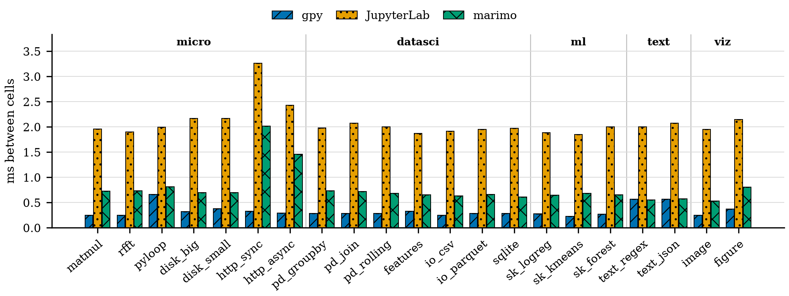

# nbbench

A tool-neutral benchmark for notebook tools. Workloads are defined once, in a neutral form, and
generated into each tool's own format: JupyterLab `.ipynb`, marimo `.py`, and gpy percent `.py`.
It measures what the tool adds on top of the user's code: start-up, the cost between cells,
memory, and how close a tool gets to the fastest schedule the cells' dependencies allow.

Status: 0.1.0.dev0. Dataset, generator, reference runner and the per-tool runner work; charts next. Design: [`docs/plans/01-nbbench-design.md`](docs/plans/01-nbbench-design.md).

## Quick start

```bash
uvx --python 3.13 --from "nbbench[workloads] @ git+https://github.com/NISH1001/nbbench" nbbench list
```

From a checkout:

```bash
uv sync --extra workloads
uv run nbbench list
uv run nbbench generate --problems domain:datasci --sizes s,m --shapes chain,dag --cells 10,100 --out build
uv run nbbench reference --problems matmul --shapes fanout --cells 50
uv run nbbench calibrate --sizes s,m
uv run pytest -q
```

Run the tools (install the `tools` extra: `uv sync --extra workloads --extra tools`):

```bash
uv run nbbench run --problems domain:datasci --shapes independent,dag --cells 10,100 --runs 5 \
    --tools gpy,gpy-concurrent,jupyterlab,marimo --results results/<name>
uv run nbbench chart results/<name>
```

`run` writes `results/<name>/results.json` (machine, versions, every run), one figure per file
(PDF for LaTeX `subfigure` and 300 dpi PNG; colour-blind safe, hatched, legends outside the data,
no titles: captions are in the folder's `README.md`) and that `README.md` summary.

The `tools` extra pins every tool: JupyterLab 4.6.6, marimo 0.25.2, ipykernel 7.4.0, and gpy at
gpython commit `d347741` (the first with concurrent cells; PyPI 0.1.2 has none). `--gpy` overrides
it with a gpython checkout, an executable or a name on PATH; gpy-concurrent is refused for a gpy
without concurrent mode. Each run is checked against the
reference checksum; the table shows `last`, `span`, `gap_ms`, `overlap`, `efficiency` and `mem_mb`
(definitions in `nbbench/run.py`). Time only on an idle machine.

`--problems` takes ids (`pd_groupby`), plan-13 ids (`C1`), `bound:cpu|disk|net` or
`domain:micro|datasci|ml|text|viz`.

## Results

Each run is a folder under [`results/`](results/) with its own summary page.

- [`results/2026-11-09-dev`](results/2026-11-09-dev/README.md): development run on a busy laptop
  (size s, 10 and 100 cells, one run each); checks the pipeline, not for citing.



## Datasheet

**Motivation.** There is no standard benchmark for notebook tools: pyperformance measures
CPython, which is the same in every tool. nbbench holds the user's code fixed and varies four
knobs, so differences between tools come from the tools. It grew out of the workload evaluation
for gpy (gpython) and is meant to be usable for any tool through a small adapter.

**Composition.** A benchmark notebook is `(problem, size, shape, N)`:

- **Problem** (21 in `datasets/problems.json`, code in `datasets/problems/`), tagged by what limits
  it (`bound`: cpu, disk, net) and by kind of work (`domain`):
  - micro (from gpy's plan 13): `matmul`, `rfft`, `pyloop`, `disk_big`, `disk_small`, `http_sync`,
    `http_async`
  - datasci: `pd_groupby`, `pd_join`, `pd_rolling`, `features`, `io_csv`, `io_parquet`, `sqlite`
  - ml: `sk_logreg`, `sk_kmeans`, `sk_forest`
  - text: `text_regex`, `text_json`
  - viz: `image`, `figure`
- **Size**: `s` ≈ 10 ms and `m` ≈ 100 ms of work per cell (data scaled per problem, calibrated
  with `nbbench calibrate`); `l` is `m` run 10 times in a row (≈ 1 s), so memory stays bounded.
  `figure` cannot go below about 30 ms at `s`.
- **Shape** (`datasets/shapes.json`): `independent`, `chain`, `fanout` (one cell feeds many, one
  combines them), `dag` (seeded layered random graph). Each has a known critical path.
- **N**: number of work cells, 1 to 1000 in the evaluation.

A notebook is one setup cell, N work cells and one collector cell. Work cell `i` runs
`x{i} = work(<inputs>, i)`, records its own start and end, and prints a digest; the collector
writes `result.json` with every span, every digest and a checksum. All data is synthetic from
fixed seeds; the network problems use a local server (`nbbench serve`) that returns the same
bytes every time.

**Rules every problem follows**, checked by the tests:

- Each public name is defined in exactly one cell (marimo's rule), so all formats mean the same thing.
- `work` never changes its input, so a tool cannot get a different answer by running cells in a different order.
- A run passes only if its checksum equals the reference checksum (`nbbench reference` runs the
  cells in order with no notebook tool).

**Samples.** `datasets/samples/` holds 24 generated notebooks (each problem at `s`, independent,
N=10; `matmul` in every shape) in all three formats, with expected checksums in `meta.json`.
Full sweeps are generated into `build/`, which is not committed.

**Verified.** The tests run the generated notebooks in marimo and in a Jupyter kernel and compare
checksums with the reference run.

**Licenses.** Code: MIT (`LICENSE`). Dataset (`datasets/`) and results: CC BY 4.0
(`LICENSE-data`).

**Related work.** JunoBench (arXiv:2510.18013) is a dataset of reproducible crashes
in ML notebooks; nbbench measures notebook tool performance instead.

## Adding a problem

1. Write `datasets/problems/<id>.py` defining `initial()`, `work(x, i)`, `combine(xs)`, `digest(x)`.
   It may read `P` (the size's parameters), `DIR`, `HOST`, `PORT`. `work` returns a value of the
   same kind as `x` and must not change `x` or any setup data.
2. Add an entry to `datasets/problems.json` with `s`, `m` and `l` parameters (`l` = `m` + `"reps": 10`).
3. `uv run nbbench calibrate --problems <id>`, adjust, then `uv run pytest -q` and `uv run nbbench samples`.

## Citing

See `CITATION.cff`.
