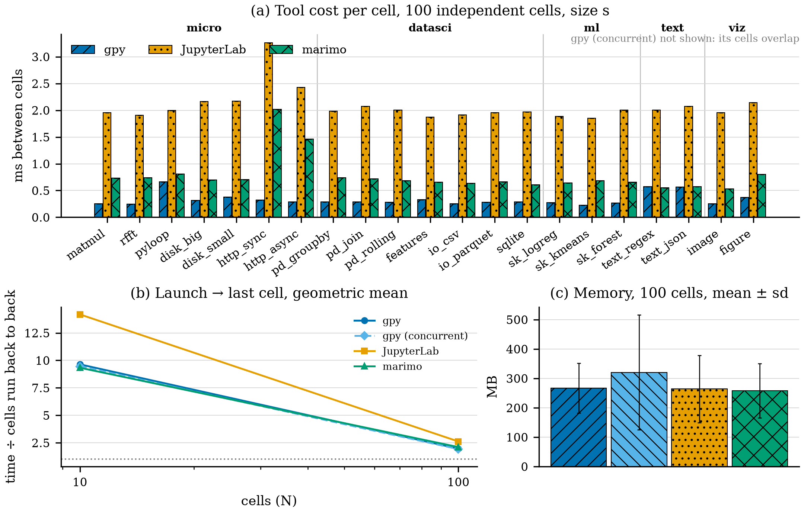
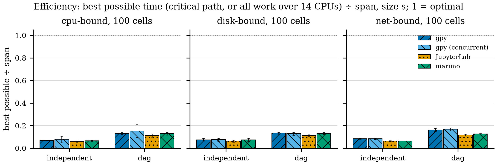
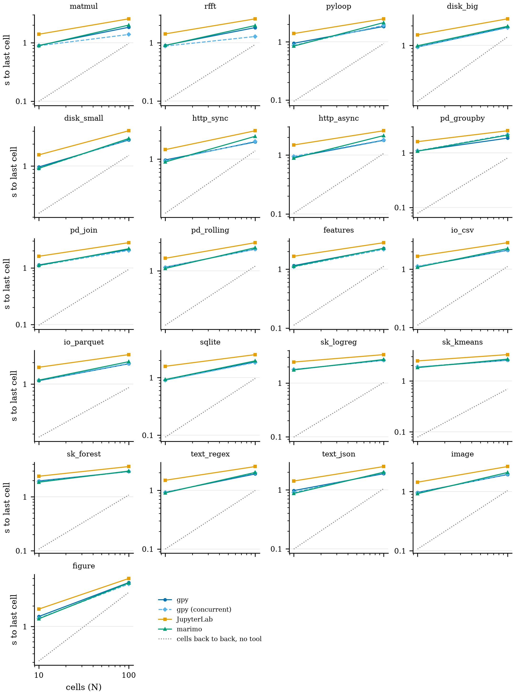

# nbbench results: 2026-11-09T10:30:48-0600

nbbench 0.1.0.dev0 on macOS-15.8.1-arm64-arm-64bit-Mach-O (14 CPUs, load 3.0 at start), Python 3.13.7.

| package | version |
|---|---|
| gpynb | 0.1.2+d34774160fd3 |
| jupyterlab | 4.6.6 |
| jupyter-server | 2.21.1 |
| ipykernel | 7.4.0 |
| marimo | 0.25.2 |
| numpy | 2.5.4 |
| pandas | 3.1.1 |
| scikit-learn | 1.9.1 |
| pyarrow | 26.0.1 |
| pillow | 13.0.0 |
| matplotlib | 3.11.2 |

## Size s

Over every problem at 100 independent cells. Slowdown: launch → last cell ÷ the cells run back to back without a tool (geometric mean). Efficiency: best possible time ÷ span, where best possible is the longer of the critical path and all work spread over every CPU (mean over every shape).

| tool | slowdown | ms between cells | efficiency | memory MB | runs ok |
|---|---|---|---|---|---|
| gpy | 1.96 | 0.29 | 0.14 | 267 | 84/84 |
| gpy (concurrent) | 1.93 | 0.26 | 0.15 | 321 | 84/84 |
| JupyterLab | 2.62 | 2.00 | 0.12 | 264 | 84/84 |
| marimo | 2.11 | 0.69 | 0.14 | 258 | 84/84 |

