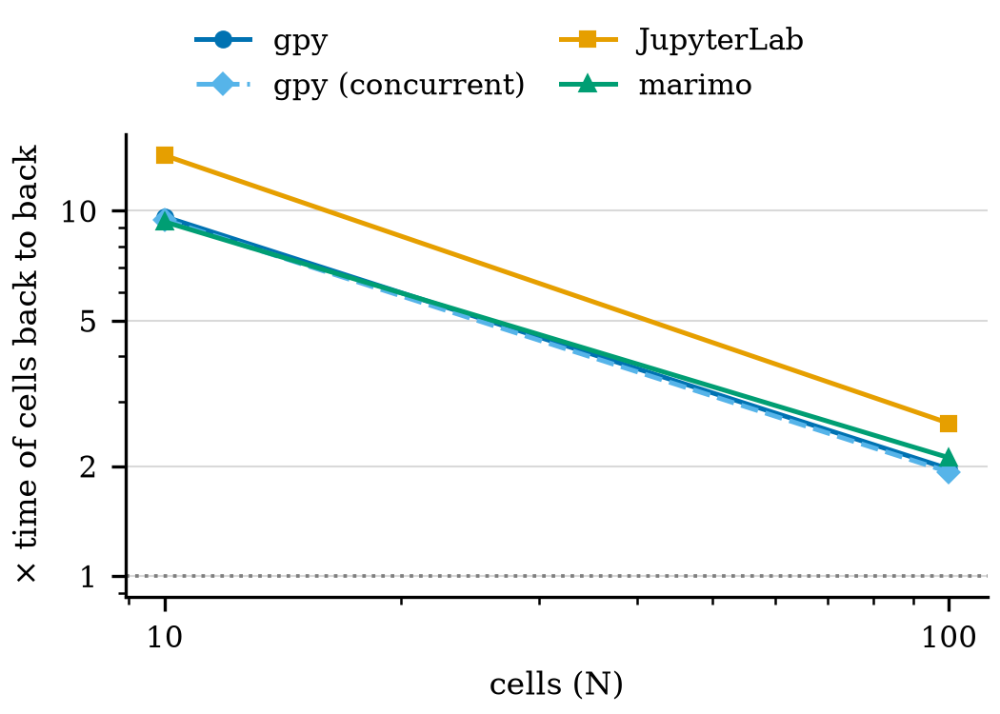
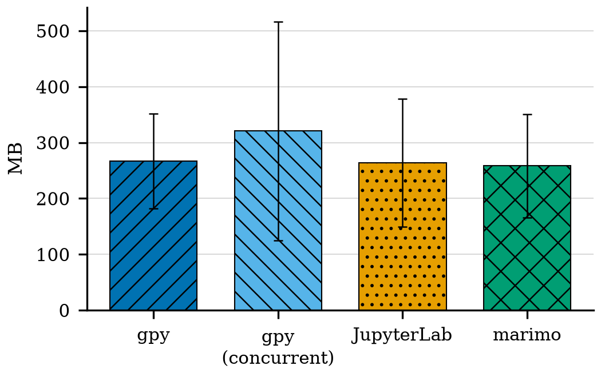
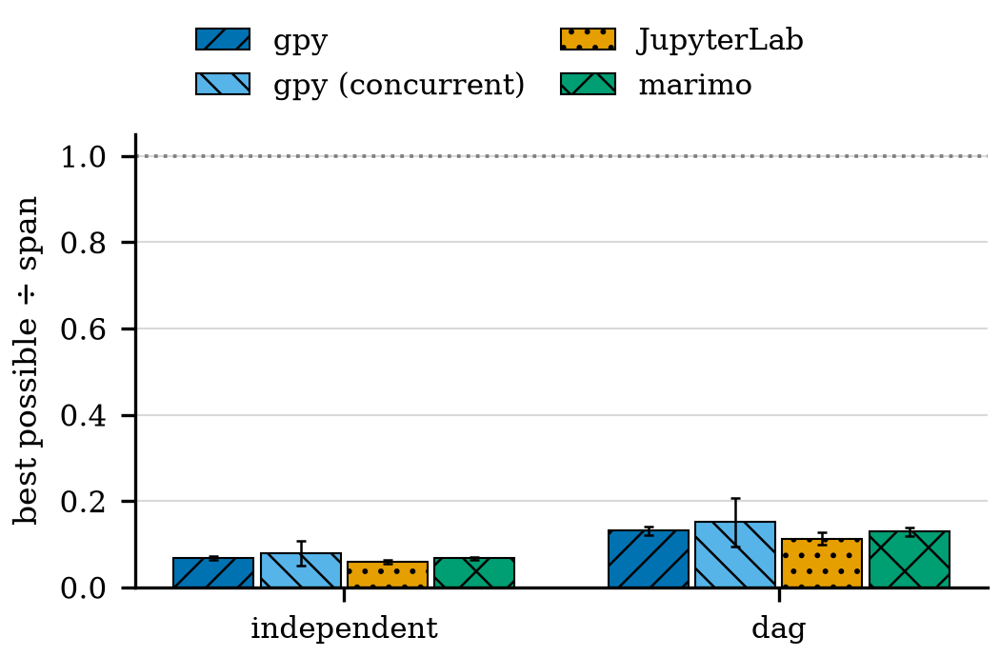
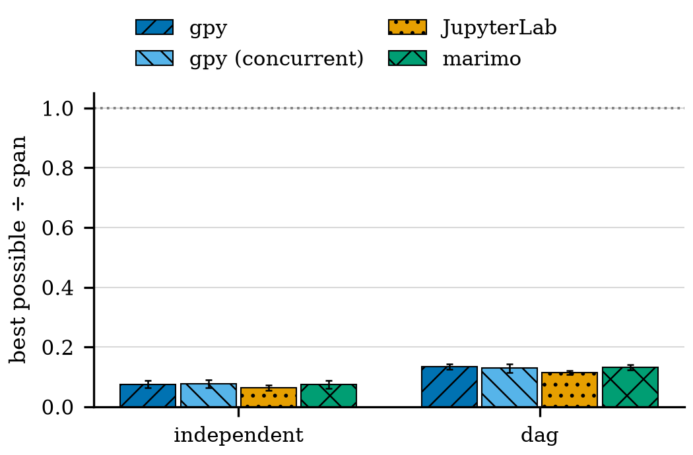
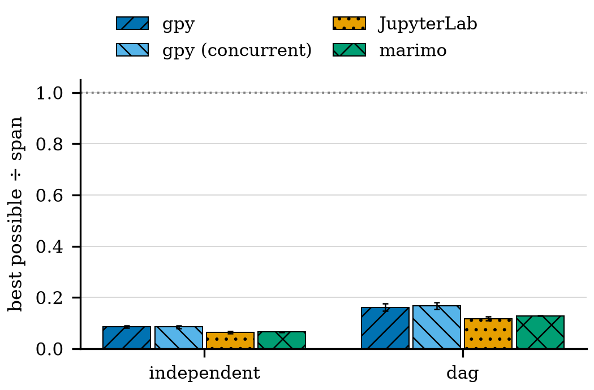
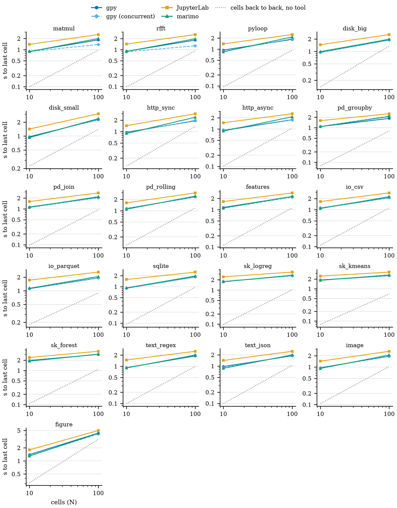

# nbbench results: 2026-11-09T10:30:48-0600

nbbench 0.1.0.dev0 on macOS-15.8.1-arm64-arm-64bit-Mach-O (14 CPUs, load 3.0 at start), Python 3.13.7.

| package | version |
|---|---|
| gpynb | 0.1.2+d34774160fd3 |
| jupyterlab | 4.6.6 |
| jupyter-server | 2.21.1 |
| ipykernel | 7.4.0 |
| marimo | 0.25.2 |
| numpy | 2.5.4 |
| pandas | 3.1.1 |
| scikit-learn | 1.9.1 |
| pyarrow | 26.0.1 |
| pillow | 13.0.0 |
| matplotlib | 3.11.2 |

## Size s

At 100 independent cells over every problem. Slowdown: launch → last cell ÷ the cells back to back with no tool (geometric mean). Efficiency: best possible time ÷ span, mean over every shape and problem.

| tool | slowdown | ms between cells | efficiency | memory MB | runs ok |
|---|---|---|---|---|---|
| gpy | 1.96 | 0.29 | 0.14 | 267 | 84/84 |
| gpy (concurrent) | 1.93 | 0.26 | 0.15 | 321 | 84/84 |
| JupyterLab | 2.62 | 2.00 | 0.12 | 264 | 84/84 |
| marimo | 2.11 | 0.69 | 0.14 | 258 | 84/84 |

**Figure s1.** Tool cost per cell: mean time between one work cell ending and the next starting, at 100 independent cells, mean ± sd over runs. Problems grouped by domain. gpy (concurrent) is left out: its cells overlap, so the gap is not defined. ([PDF](cost_per_cell_s.pdf))

**Figure s2.** Launch until the last cell finishes, divided by the time the same cells take back to back with no tool (geometric mean over problems, independent cells). 1 = no cost beyond the work; below 1 = faster than back to back. ([PDF](slowdown_s.pdf))

**Figure s3.** Memory of each tool's process tree when the last cell finished, 100 independent cells, mean ± sd over problems. ([PDF](memory_s.pdf))

**Figure s4.** cpu-bound problems at 100 cells: best possible time (the longer of the critical path and all work spread over 14 CPUs) divided by the measured span, mean ± sd over problems. 1 = no schedule on this machine could be faster. ([PDF](efficiency_cpu_s.pdf))

**Figure s5.** disk-bound problems at 100 cells: best possible time (the longer of the critical path and all work spread over 14 CPUs) divided by the measured span, mean ± sd over problems. 1 = no schedule on this machine could be faster. ([PDF](efficiency_disk_s.pdf))

**Figure s6.** net-bound problems at 100 cells: best possible time (the longer of the critical path and all work spread over 14 CPUs) divided by the measured span, mean ± sd over problems. 1 = no schedule on this machine could be faster. ([PDF](efficiency_net_s.pdf))

**Figure s7.** Launch until the last cell finishes against N for each problem (independent cells, log–log). Dotted: the cells back to back with no tool. ([PDF](per_problem_s.pdf))

